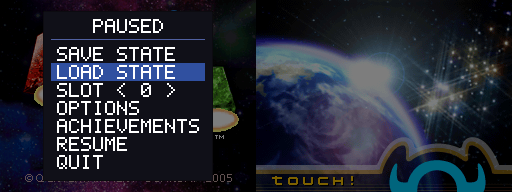
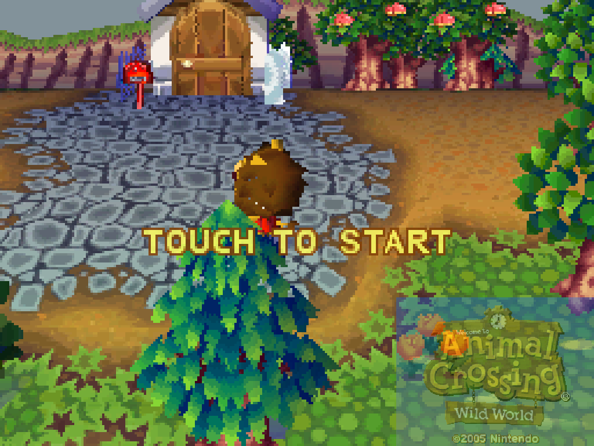
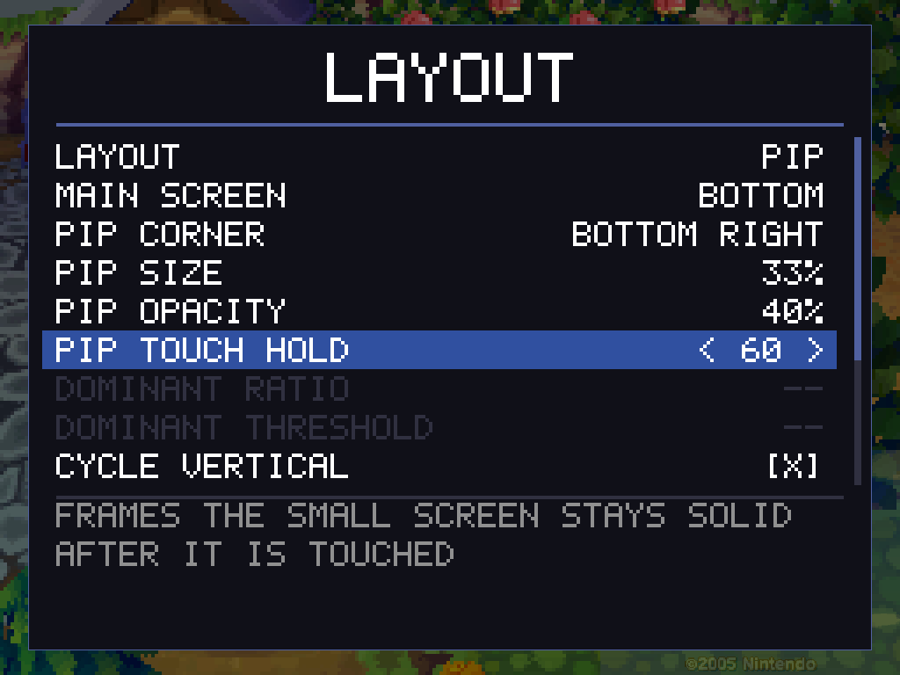

# DSperate (Nintendo DS Emulator)

AI DISCLAIMER: Agentic coding is used here. A lot. I am not smart enough to keep track
of all of this with the wet electric meat lump that sits inside my skull.

A Nintendo DS and DSi emulator that reimplements DraStic's JIT and NEON rendering
techniques, with modern niceties from melonDS such as per-screen windows and
local wireless.
Built for and measured on ARM handhelds (the Anbernic RG DS, an RK3566 with
four A55 cores); commercial games boot and play. Everything is verified against
melonDS with frame dumps and instruction traces.

DSperate is a **clean-room** reimplementation of DraStic's *techniques*,
documented by studying its freely-distributable debug-symbol build (approved
for distribution by its developer, Exophase) and measuring it on real
hardware. No DraStic code is in this tree. See [docs/techniques](docs/techniques).

## Previews

## Features

### Core

- **Both CPUs, interpreted or recompiled.** ARM946E-S and ARM7TDMI
  interpreters on every host; an ARM → AArch64 recompiler and an ARM → ARMv7
  recompiler ([src/core/cpu/jit/README.md](src/core/cpu/jit/README.md)),
  verified instruction by instruction against the interpreter.
- **melonDS-grade cycle timing** with per-page cost tables and TCM windows,
  plus an idle-loop detector that proves a poll loop side-effect-free and skips
  to the next event.
- **Event-bound CPU interleave** as DraStic does it: each CPU runs to the
  next scheduled event.
- **Full system.** DMA with burst timing, timers, IPC, SPI (touchscreen,
  firmware flash, power management, microphone), RTC, divider/sqrt, and Wi-Fi
  with real frames (see *Local wireless and internet* below).
- **Fastmem.** The recompilers reach guest RAM through host-mapped views on
  AArch64 and ARMv7, DS and DSi alike.
- **Retail cartridges.** KEY1/KEY2 protocol, direct boot, per-title save-chip
  database (EEPROM and FLASH variants), and IR-cart pass-through for the
  Pokémon titles that need it. The GBA slot is empty.
- **Zipped ROMs.** `.zip` files holding an `.nds` load directly (detected by
  magic, not extension), with an on-disk unpack cache. No zip64, 7z or rar.
- **2D.** Both engines complete: every BG mode, sprites, windows, mosaic,
  blending, extended palettes, display capture, display FIFO, master
  brightness. Rendered lazily in one batch per frame from a write journal,
  engine B on a worker thread, with NEON line kernels.
- **3D.** Full geometry engine (timed command FIFO, matrix stacks, lighting,
  clipping, tests) and a software rasteriser (textures, toon/highlight,
  shadows, fog, edge marking, anti-aliasing) that matches melonDS pixel for
  pixel. Runs asynchronously on three worker threads with a decoded-texture
  cache and a skip for resubmitted frames.
- **GPU 3D** (`video.gpu3d`, `--gpu3d`, the GPU 3D menu row, off by default):
  the same polygon lists drawn by Vulkan instead, at the DS's resolution with
  4x MSAA, the DS's depth, stencil, shadow and translucency rules on the
  hardware pipeline, and the finished layer read back for the 2D compositor.
  The frame may be one behind under load (never on a frame the game captures).
  The software rasteriser stays the exact reference and the fallback: what the
  GPU draws may differ from it within reason, never in what is on screen. On
  the RG DS Plus it takes the heaviest scenes (Golden Sun: Dark Dawn, Spirit
  Tracks) from a few hundred frames over budget per minute to a handful.
- **Sound.** All sixteen SPU channels (PCM8/16, ADPCM, PSG, noise) and capture
  units, mixed at the console's real 32728.5 Hz. The frontend paces from its own
  frame limiter at the console's rate, not from the audio queue, and keeps the
  host's CPU governor and real-time throttling from stealing frames.
- **No dumps required.** Without BIOS/firmware files, a built-in FreeBIOS and a
  generated firmware run games by direct boot. Real dumps (`bios9.bin`,
  `bios7.bin`, `firmware.bin`, never provided here) unlock the firmware menu and
  exact timing.

### Nintendo DSi (experimental)

- **DSiWare without a NAND.** A `.nds` or `.cia` DSiWare title runs with only the
  BIOS dumps (all four: DS and DSi): DSperate synthesises the console, its
  settings, the NAND and a system font of its own, and hands the title over the
  way the DSi Menu would.
- **A real NAND.** With `--dsi-mode` and your own `nand.bin`, the console boots
  to the DSi Menu. The NAND is read-only; writes live in memory and persist
  beside it. A named title is installed into the session, and installed titles
  can be started directly through NAND title shortcuts.
- **DSi hardware.** SD card slot backed by a host folder (synced back, deletions
  included), microphone, DSi Wi-Fi, PictoChat, and Download Play from the Menu.
- **Save states, the recompiler, idle skip and fastmem** all work in DSi sessions.
- **Not yet:** the DSP (titles that start it warn, and camera or DSP audio apps
  will not work) and DSi-enhanced carts in DSi mode (they run as DS games).

### Local wireless and internet

- **Local wireless over the LAN**, speaking melonDS's protocol so either end can
  be melonDS: `--lan-host`, `--lan-join`, or `--netplay` to join whoever is on
  the LAN or host otherwise. Multiplayer and Download Play work, across devices.
- **Internet** through the emulated access point over a user-mode TCP/IP stack
  (vendored libslirp; no privileges). Wiimmfi connects.
- **NETWORK FEATURES** in the pause menu turns a session on or off mid-run. While
  one is live, the speed knobs, fast forward, frameskip and save states are off,
  so both consoles stay on the same clock.

### Playing

- **Save states.** Ten slots plus a hidden auto slot that can be written on
  quit and resumed on the next launch. Exact round trip, includes the screen
  layout and achievement progress, refuses to load across a different BIOS.
  DSi states carry the NAND and SD card changes too.
- **Battery saves** written shortly after the game stops writing and again on
  pause, lid close and exit (SIGTERM included).
- **Pause menu** drawn over the game and driven with the DS buttons: save/load,
  slot list, cheats, options pages (emulation, visual effects, layout,
  controls, DS settings), achievements, resume and quit.
- **Action Replay cheats** from a `usrcheat.dat` database, matched by game
  code and header checksum, toggled per game from the pause menu.
- **RetroAchievements** (Casual mode only, no Hardcore) via rcheevos: sign in
  with a username or a token the CFW already holds, unlock toasts, an
  achievements list and account page in the pause menu, encore mode, and an
  optional screenshot on unlock. DS games and DSiWare, however they are
  started. Uses the system's libcurl at runtime.
- **Firmware boot.** With no ROM the console boots its own DS menu with the
  clock set from the host. Settings changed inside it are kept in a sidecar
  file so the dump is never written to. A built-in loader cart in the slot
  raises a game picker from `[paths] games`; the chosen game is direct-booted.
- **Fast forward** (held or toggled, optionally capped) and **frameskip**
  (adaptive or fixed) that skips only drawing, so the emulation stays exact.
  Skipping runs in whole display periods for games that alternate screens.
- **Input recording and replay.** A played session becomes a deterministic,
  reproducible benchmark; [scenes/](scenes/) holds the ones used in the docs.
- **Microphone and lid.** Real ALSA capture (DC-blocked and noise-gated) or a
  held-key fake mic; a real hinge switch, host suspend, or a hotkey drives the
  lid.
- **Controls.** Keyboard and controller remapping, controller hotkeys as
  `mod+button` chords, a stick as the d-pad or face buttons, a stick-driven
  stylus crosshair, per-axis analog remapping for pads whose sticks SDL reports
  rotated or mirrored, and touch or mouse on the bottom screen. Pad buttons are
  read by position (SDL's a/b/x/y as south/east/west/north), which the menu
  shows as position pips; if a pip doesn't match the button pressed, the
  controller's SDL mapping is wrong and should be fixed there
  (`SDL_GAMECONTROLLERCONFIG`), not by rebinding.
- **Config.** An INI in `~/.config/dsperate/` with every key commented, per-game
  override files by ROM name or game code; [configs/default.ini](configs/default.ini)
  is the full default file.

### Display

- **Layouts:** vertical, horizontal, single, picture-in-picture, and two
  "dominant" modes where one screen takes the largest whole scale and the other
  fills what is left. Hotkeys cycle layouts and swap screens, remembered per game.
- **Scaling filters** applied per scanline straight into the presented buffer:
  nearest, bilinear, LCD grid, box-filter seams (sharp, shimmer-free), and
  chunky 2x2 cells; optional integer scaling (letterbox or crop).
- **3D anti-aliasing** (`video.aa`, `--aa`, the ANTI-ALIASING menu row): the
  hardware's own edge blend on the software rasteriser (pixel-exact with
  melonDS), 4x MSAA on the GPU one, which also smooths the creases and cut-out
  edges the DS leaves stepped.
- **Screen gap** (`video.screen_gap`, `--screen-gap`): a distance in panel
  pixels between the two screens of a stacked, side-by-side or dominant pair,
  or `auto`, which pushes them to the panel's edges when the fit leaves room.
- **Fastest path to the panel, chosen automatically:** the display engine's
  hardware scaler on Allwinner handhelds (Miyoo A30), fbdev on the H700 boards,
  zero-copy dmabuf under Wayland with direct scanout where allowed, our own page
  flips under KMSDRM, and SDL's renderer only where nothing else applies.
- **Scaling off the CPU** (`video.gpu_present`, on by default where it works):
  the DS-resolution frames are scaled and laid out into the scanout buffer by
  the Rockchip RGA (the RK3566's 2D accelerator, through V4L2) where the
  device has one, else by a Vulkan compute pass. The RGA leaves the GPU to the
  3D layer alone. With bilinear off, views are resized by nearest neighbour
  on the CPU and copied by RGA at 1:1, keeping them crisp at any scale,
  including fractional scales and small insets. Optional integer scaling
  still adds borders or crops when requested. Bilinear on keeps RGA's smooth
  scaling. It draws the LCD grid and a fading PiP inset; blended seams and
  chunky cells remain unavailable.
  Rotated panels and everything else fall back to the scanline scaler.
- **Dual-window mode** for dual-panel handhelds: one fullscreen window per
  display, one DS screen each.
- **On-screen overlays:** FPS counter, state slot number, screenshot flash,
  achievement toasts.

## Building

Requires CMake ≥ 3.16, Ninja, a C++17 compiler, and SDL2 for the playable
frontend. The only vendored third-party code is miniz's DEFLATE decompressor
and rcheevos.

    cmake --preset host && cmake --build --preset host && ctest --preset host

Cross builds: `aarch64-cross` (needs `aarch64-linux-gnu-g++`) and
`arm32-cross` (needs `arm-linux-gnueabihf-g++`); tests run under
`qemu-*-static` when present. The recompiler and NEON kernels build only on
AArch64 and ARMv7 hosts; elsewhere you get the interpreter and the portable
renderer.

CMake switches: `DSPERATE_JIT`, `DSPERATE_NEON`, `DSPERATE_TESTS`,
`DSPERATE_HEADLESS`, `DSPERATE_SDL`, `DSPERATE_WAYLAND`, `DSPERATE_CHEEVOS`,
`DSPERATE_HARDEN`, and `DSPERATE_PGO=generate|use` (profiles for AArch64 and
ARMv7 are committed under [pgo/](pgo/)).

## Running

    dsperate [game.nds|game.zip|title.cia] [--bios9 F --bios7 F --firmware F] [options]
    dsperate --dsi-mode --bios9i F --bios7i F [--dsi-nand nand.bin] [title] [options]

`dsperate --help` lists every option; each has a key in the settings file and
the command line overrides it. Default keys: arrows and `X`/`Z`/`S`/`A`/`Q`/`W`
for the face and shoulder buttons, Enter/Right Shift for Start/Select, `P`
pause menu, `Tab` fast forward, `F5`/`F7` save/load state, `F2`/`F3` change
slot, `F4`/`F10` cycle layout, `F6` swap screens, `F9` screenshot, `L` lid,
`M` fake microphone, `F` fullscreen, `Escape` quit.

`dsperate-headless` is the measurement harness: no window or audio, boots the
firmware or a ROM with `--direct`, and offers instruction traces, frame and
audio dumps, save-state checkpoints and cheats from the command line. It never
writes a battery save back.

## Diagnostics, tests and tools

Environment variables (`DS_VERBOSE`, `DS_FRAME_STATS`, `DS_FPS`, `DS_PROFILE`,
`DS_FRAME_HASH`, `DS_IO_CENSUS`, `DS_JIT_*` and others) are documented where
they are read. `ctest` runs the unit tests in
[tests/](tests/): interpreter, recompiler against interpreter, NEON kernels
against portable references, page table, scheduler, I/O, SPU, 2D/3D pipelines
and the texture cache. [tools/](tools/) holds the PGO refresh scripts, the shader and example-config
generators, the release ABI-floor check, `mkdsin.py` for scripting an input
replay, and `mkcart.py` for building a custom loader cart.

## Licence

GPLv3 — see [LICENSE](LICENSE). melonDS (GPLv3) is used as reference and, with
attribution, as a code source. FreeBIOS is under its own licence in
[src/core/bios/LICENSE.freebios](src/core/bios/LICENSE.freebios).
